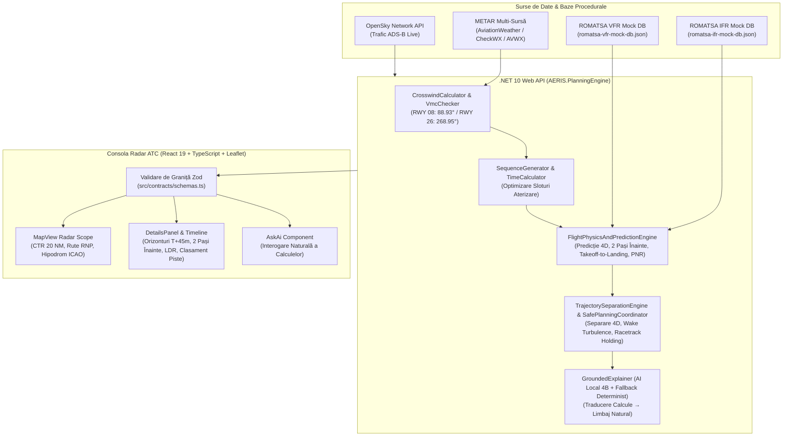

# Documentație Tehnică, Matematică și Operațională — Sistemul AERIS (`LRCV`)

**AERIS (KWAD)** este un sistem integrat de **Arrival Management (AMAN), Predicție 4D a Viitorului, Separare a Traiectoriilor și Suport Decizional ATC** proiectat pentru **Aeroportul Internațional Craiova (`LRCV` / `CRA`)**.

Acest document descrie arhitectura sistemului, modelele fizice și matematice utilizate în motorul de simulare, structura bazelor de date procedurale ROMATSA (IFR & VFR), mecanismul de traducere în limbaj natural prin AI-ul local de 4B parametri și ghidul de utilizare a aplicației.

---

## Cuprins
1. [Viziune și Arhitectură Generală](#1-viziune-și-arhitectură-generală)
2. [Geometria Aerodromului Craiova (`LRCV`) și Bazele de Date ROMATSA](#2-geometria-aerodromului-craiova-lrcv-și-bazele-de-date-romatsa)
3. [Motorul Fizic și Matematic de Predicție (`FlightPhysicsAndPredictionEngine`)](#3-motorul-fizic-și-matematic-de-predicție-flightphysicsandpredictionengine)
   - 3.1. Atmosfera Standard ISA, Altitudinea de Densitate și Conversia IAS → TAS
   - 3.2. Forfecarea Verticală a Vântului (Legea lui Hellmann & Spirala Ekman)
   - 3.3. Predicția Viitorului 4D (`T+0` → `T+45 min`)
   - 3.4. Triunghiul Vitezelor, Unghiul de Derivă (`WCA`) și Componentele Vântului pe Pistă
   - 3.5. Analiza Completă De-la-Decolare-la-Aterizare (6 Faze, `TOD`, `ROD`, Energie Specifică, `LDR`, `ROT`)
   - 3.6. Predicția Anticipativă „Doi Pași Înaintea Avionului” (`T0` → `Pas +1` → `Pas +2`)
   - 3.7. Decizia Matematică VFR: Orbită vs. Redirecționare (`PNR` & Scorul Multi-Criterial `0–100`)
4. [Motorul de Secvențiere și Separare 4D a Traiectoriilor](#4-motorul-de-secvențiere-și-separare-4d-a-traiectoriilor)
5. [Integrarea Datelor Live (OpenSky, METAR Multi-Sursă, VMC & VFR Geofence)](#5-integrarea-datelor-live-opensky-metar-multi-sursă-vmc--vfr-geofence)
6. [Traducătorul AI Local 4B (`GroundedExplainer`)](#6-traducătorul-ai-local-4b-groundedexplainer)
7. [Arhitectura Frontend (Consola Radar ATC React 19 + Leaflet)](#7-arhitectura-frontend-consola-radar-atc-react-19--leaflet)
8. [Catalogul Complet al Endpoint-urilor API](#8-catalogul-complet-al-endpoint-urilor-api)
9. [Ghid de Prezentare Demo (Hackathon Walkthrough)](#9-ghid-de-prezentare-demo-hackathon-walkthrough)

---

## 1. Viziune și Arhitectură Generală

AERIS rezolvă o problemă critică a aeroporturilor regionale în dezvoltare rapidă precum **Craiova (`LRCV`)**, unde **traficul comercial greu IFR** (Airbus A320/A321neo, ATR 72-600) împarte același spațiu aerian de clasă C (CTR Craiova, rază $20\text{ NM}$) cu **aviația generală și ultraușoară VFR** (ICP Savannah S, PZL-104 Wilga 35A, Cessna 172), adesea lipsită de avionică instrumentală și extrem de vulnerabilă la vântul lateral de sud/sud-vest.

Principiul arhitectural fundamental al AERIS este:
> **Matematica și fizica deterministă iau deciziile critice de siguranță; modelul AI local (4B) doar traduce calculele verificate în limbaj natural.**

---

## 2. Geometria Aerodromului Craiova (`LRCV`) și Bazele de Date ROMATSA

Datele geometrice sunt extrase din **AIP România (AIRAC 2026-10-01)**:
- **Punctul de referință al aerodromului (ARP):** $44^\circ 19' 05''\text{ N}, 23^\circ 53' 19''\text{ E}$ ($44.318056^\circ\text{ N}, 23.888611^\circ\text{ E}$), elevație $626\text{ ft}$ ($191\text{ m}$) AMSL.
- **Pista `08/26` ($2500\text{ m} \times 45\text{ m}$, asfalt, PCN 64/R/B/W/T):**
  - **Pragul `THR 08`:** $44.317778^\circ\text{ N}, 23.873278^\circ\text{ E}$, elevație $678\text{ ft}$, relevment adevărat (**True Bearing**) $\psi_{08} = 88.93^\circ$.
  - **Pragul `THR 26`:** $44.318222^\circ\text{ N}, 23.905639^\circ\text{ E}$, elevație $669\text{ ft}$, relevment adevărat (**True Bearing**) $\psi_{26} = 268.95^\circ$ (dotată cu ILS Cat I + RNP).
  - *Notă de compatibilitate:* Clasa `RunwayConfiguration` normalizează automat atât designatoarele actuale `08/26`, cât și cele istorice `09/27`.

### Bazele de Date JSON de tip ROMATSA
1. **`AERIS API/data/romatsa-ifr-mock-db.json` (Baza IFR):**
   - Reguli de separare FIR București (`LRBB`), matricea ICAO de turbulență de siaj (`Heavy`, `Medium`, `Light`), procedurile de apropiere instrumentală `ILS/RNP RWY 26` (IAF `TITEK`, `PEMOK`, `PANZU` $\to$ IF `OZZET` $\to$ FAF `CV508` $\to$ `THR 26`) și `RNP RWY 08` (IF `NECCO` $\to$ FAF `CV408` $\to$ `THR 08`), procedurile de *Missed Approach*, holding-urile publicate la `OZZET` și `NECCO`, profilurile cinematice BADA (`A320-232`, `A321neo`, `ATR 72-600`, `B737-800`, `E190`) și aerodromurile de degajare IFR (`LROP`, `LRTR`, `LRSB`, `LBSF`).
2. **`AERIS API/data/romatsa-vfr-mock-db.json` (Baza VFR):**
   - Punctele de raportare VFR (`VFR-S` Dunăreni, `VFR-N` Șimnicu de Sus, `VFR-W` Breasta), regulile VMC conform SERA.5001, performanțele aeronavelor VFR/ULM (`ICP Savannah S`, `PZL-104 Wilga 35A`, `Cessna 172S`, `Diamond DA40`, `Tecnam P2008JC`) și pistele înierbate regionale de redirecționare (`PODARI`, `LRCW` Craiova-Sud/Balta Verde, `SLATINA`).

---

## 3. Motorul Fizic și Matematic de Predicție (`FlightPhysicsAndPredictionEngine`)

Toate formulele sunt implementate în `AERIS API/Services/FlightPhysicsAndPredictionEngine.cs` și oglindite în `frontend/src/api/mockBackend.ts`.

### 3.1. Atmosfera Standard ISA, Altitudinea de Densitate și Conversia IAS → TAS
Pentru elevația aerodromului $h_{\text{elev}} = 626\text{ ft}$, temperatura standard ISA este:
$$T_{\text{ISA}}(h) = 15.0 - 0.0019812 \cdot h_{\text{ft}} \approx 13.76^\circ\text{C}$$

Altitudinea barometrică ($\text{PA}$) și altitudinea de densitate ($\text{DA}$) în funcție de presiunea $\text{QNH}$ și temperatura exterioară $\text{OAT}$:
$$\text{PA} = h_{\text{elev}} + (1013.25 - \text{QNH}) \cdot 27.3$$
$$\text{DA} = \text{PA} + 118.8 \cdot (\text{OAT} - T_{\text{ISA}})$$

Raportul de densitate atmosferică $\sigma = \rho / \rho_0$ la altitudinea $h$ determină viteza adevărată ($\text{TAS}$) din viteza indicată ($\text{IAS}$):
$$\sigma(h) = \frac{P(h)}{P_0} \cdot \frac{T_0}{T(h)}, \qquad \text{TAS} = \frac{\text{IAS}}{\sqrt{\sigma(h)}}$$

### 3.2. Forfecarea Verticală a Vântului (Legea lui Hellmann & Spirala Ekman)
Vântul măsurat la anemometru ($h_{\text{ref}} = 10\text{ m} \approx 33\text{ ft}$) nu este identic cu vântul întâlnit pe panta de apropiere la $2000\text{ ft}$ sau în holding la $5000\text{ ft}$. Motorul calculează:
1. **Viteza vântului la altitudinea $h_{\text{AGL}}$ (Legea puterii lui Hellmann):**
   $$V(h_{\text{AGL}}) = V_{\text{ref}} \cdot \left(\frac{\max(h_{\text{AGL}}, 33\text{ ft})}{33\text{ ft}}\right)^\alpha$$
   unde exponentul de rugozitate și instabilitate $\alpha \in [0.14, 0.22]$ depinde de factorul de rafală $(V_{\text{gust}} - V_{\text{sustained}})$.
2. **Direcția vântului în altitudine (Spirala Ekman în stratul limită planetar):**
   $$\theta_{\text{wind}}(h_{\text{AGL}}) = \left(\theta_{\text{surface}} + 18^\circ \cdot \left(1 - e^{-h_{\text{AGL}} / 2500\text{ ft}}\right)\right) \bmod 360^\circ$$

### 3.3. Predicția Viitorului 4D (`T+0` → `T+45 min`)
Funcția `BuildFuturePrediction` evaluează șase orizonturi de timp discrete:
$$\mathcal{H} = \{0, 5, 10, 15, 30, 45\}\text{ minute}$$
La fiecare orizont $T + \Delta t$, motorul modelează relaxarea turbulentă a energiei cinetice a rafalelor spre echilibrul sinoptic, recalculează pista optimă (`RWY 08` vs `RWY 26`), verifică dacă fereastra VFR devine legală și sigură ($V_{\text{xw}} \le 12\text{ kt}$ și vizibilitate $\ge 5000\text{ m}$) și numără aeronavele aflate în zbor activ, în holding sau deja aterizate.

### 3.4. Triunghiul Vitezelor, Unghiul de Derivă (`WCA`) și Componentele Vântului pe Pistă
Pentru o aeronavă care urmărește un drum impus față de sol $\chi$ (de exemplu, axul pistei $\psi_{\text{rwy}}$) cu viteza adevărată $\text{TAS}$ în prezența unui vânt din direcția $\theta_w$ de viteză $V_w$:
- **Componenta laterală (*Crosswind*) și frontală (*Headwind*):**
  $$\Delta\theta = \theta_w - \chi, \qquad V_{\text{xw}} = V_w \cdot \sin(\Delta\theta), \qquad V_{\text{hw}} = V_w \cdot \cos(\Delta\theta)$$
- **Unghiul de corecție a derivei (*Wind Correction Angle / Crab Angle*):**
  $$\text{WCA} = \arcsin\left(\text{clamp}\left(\frac{V_{\text{xw}}}{\text{TAS}}, -0.85, 0.85\right)\right)$$
- **Capul compas de zburat (*Heading to Fly*) și Viteza față de sol (*Ground Speed*):**
  $$\text{HDG} = (\chi + \text{WCA}) \bmod 360^\circ, \qquad \text{GS} = \text{TAS} \cdot \cos(\text{WCA}) - V_{\text{hw}}$$

### 3.5. Analiza Completă De-la-Decolare-la-Aterizare (6 Faze, `TOD`, `ROD`, Energie Specifică, `LDR`, `ROT`)
Pentru fiecare aeronavă, `BuildTakeoffToLandingAnalysis` construiește profilul complet al misiunii în **6 faze** (`1. Takeoff & Initial Climb`, `2. Enroute Cruise`, `3. Top of Descent`, `4. Initial Approach IAF/IF`, `5. Final Approach FAF 3.0°`, `6. Touchdown & Rollout`):
- **Distanța *Top of Descent* ($\text{TOD}$):**
  $$D_{\text{TOD}} = \frac{h_{\text{cruise}} - h_{\text{elev}}}{6076.12 \cdot \tan(3.0^\circ)} \cdot \frac{\text{GS}_{\text{desc}}}{\text{TAS}_{\text{desc}}} + \Delta D_{\text{decel}} \approx 3.18 \cdot \frac{\Delta h_{\text{ft}}}{1000} \text{ NM}$$
- **Rata de coborâre necesară ($\text{ROD}$) pe panta nominală de $\gamma = 3.0^\circ$:**
  $$\text{ROD}_{\text{fpm}} = \text{GS}_{\text{app}} \cdot \frac{6076.12}{60} \cdot \tan(3.0^\circ) \approx \text{GS}_{\text{app}} \cdot 5.307 \text{ ft/min}$$
- **Înălțimea Energetică Specifică Totală ($E_s$) la poarta de stabilizare ($1000\text{ ft AGL}$):**
  $$E_s = h_{\text{gate}} + \frac{V_{\text{TAS}}^2}{2g}$$
- **Distanța de Aterizare Necesară ($\text{LDR}$) față de Pista Disponibilă ($\text{LDA} = 2500\text{ m}$):**
  $$\text{LDR} = \left(D_{\text{air}, 50\text{ft}} + \frac{V_{\text{td, m/s}}^2}{2 \cdot a_{\text{dec}}}\right) \cdot \left(\frac{\rho_0}{\rho}\right) \cdot f_{\text{surface}} \cdot 1.15$$
  unde $V_{\text{td}}$ este viteza față de sol la contactul cu pista ($V_{\text{ref}} - V_{\text{hw}}$), iar factorul $1.15$ reprezintă marja operațională de siguranță.

### 3.6. Predicția Anticipativă „Doi Pași Înaintea Avionului” (`T0` → `Pas +1` → `Pas +2`)
Funcția `BuildTwoStepsAhead` oferă controlorului de trafic viziunea anticipativă în trei puncte sincronizate cu cronologia simulării:
1. **$T_0$ (`t = t_target - 540s`):** Aeronava la intrarea în sectorul TMA/CTR ($12\text{–}15\text{ NM}$ de prag), cu viteza de intrare și acțiunea de verificare QNH/alocare secvență.
2. **Pasul +1 (`t = t_target - 210s`):** Poziția tactică viitoare — fixul intermediar (`OZZET` pentru `RWY 26`, `NECCO` pentru `RWY 08`, punctul de aliniere VFR la $3\text{ NM}$ sau intrarea în hipodromul de așteptare), împreună cu capul corectat la vânt și instrucțiunea ATC exactă.
3. **Pasul +2 (`t = t_target`):** Rezoluția finală — touchdown pe `THR 08/26` (cu timpul de eliberare a pistei $\text{ROT}$), reevaluarea în holding sau aterizarea pe pista alternativă recomandată.

### 3.7. Decizia Matematică VFR: Orbită vs. Redirecționare (`PNR` & Scorul Multi-Criterial `0–100`)
Când vântul lateral pe `LRCV` depășește limita demonstrată a unei aeronave VFR (de ex. $11\text{ kt}$ pentru `ICP Savannah S` la un vânt de sud de $22\text{G}26\text{ kt}$), motorul decide matematic între **așteptare în orbită** și **redirecționare imediată**:
1. **Calculul *Point of No Return* ($\text{PNR}$):**
   $$T_{\text{PNR}} = \frac{\left(T_{\text{fuel, actual}} - T_{\text{rezervă VFR (30m)}} - T_{\text{zbor spre alternativă}}\right) \cdot \dot{m}_{\text{cruise}}}{\dot{m}_{\text{hold}}}$$
   Deoarece consumul în holding la viteză de anduranță maximă este $\dot{m}_{\text{hold}} \approx 0.78 \cdot \dot{m}_{\text{cruise}}$, fiecare minut de combustibil de croazieră oferă $\approx 1.28\text{ minute}$ de așteptare în orbită.
   - Dacă $T_{\text{PNR}} < 12\text{ min}$, decizia este **`DivertImmediately`**.
   - Dacă $T_{\text{PNR}} \ge 12\text{ min}$ și prognoza la $T+15\text{m}$ indică scăderea vântului sub limită, decizia este **`HoldInOrbitThenLand`**, altfel **`OrbitThenLandOrDivert`**.
2. **Scorul Multi-Criterial ($0\text{–}100$) pentru Alegerea Celei Mai Bune Piste din Apropiere:**
   Fiecare aerodrom alternativ (`PODARI`, `LRCW` Craiova-Sud, `SLATINA`) primește un scor compus:
   $$S_{\text{total}} = 0.55 \cdot S_{\text{crosswind}} + 0.20 \cdot S_{\text{headwind}} + 0.15 \cdot S_{\text{distance}} + 0.10 \cdot S_{\text{fuel}}$$
   La vânt puternic de sud ($180^\circ / 22\text{G}26\text{ kt}$), **Aerodromul Podari (`PODARI`, pista `20` orientată pe $200^\circ$)** reduce vântul lateral de la $26.0\text{ kt}$ (pe Craiova) la doar **$8.9\text{ kt}$** (sub limita de $11\text{ kt}$ a aeronavei Savannah S), obținând scorul maxim ($\approx 84/100$) și fiind marcat cu `★ OPTIM`.

---

## 4. Motorul de Secvențiere și Separare 4D a Traiectoriilor

Implementat în `AERIS API/Services/TrajectorySeparation/`:
- **`TrajectoryPredictor.cs` & `RacetrackGenerator.cs`:** Construiește traiectorii 4D eșantionate la $5\text{ s}$ pe rutele RNP publicate în AIP România și generează circuite standard de așteptare de tip hipodrom ICAO (*Racetrack*: fix $\to$ viraj $180^\circ$ rată 1 $\to$ segment outbound $60\text{ s}$ $\to$ viraj $180^\circ$ $\to$ segment inbound).
- **`TrajectorySeparationEngine.cs`:** Verifică toate perechile de aeronave $(i, j)$ la fiecare pas de timp $t$:
  - **Separare IFR–IFR:** $3.0\text{ NM}$ orizontal sau $1000\text{ ft}$ vertical.
  - **Separare IFR–VFR și VFR–VFR în Clasa C:** $1.5\text{ NM}$ / $500\text{ ft}$ (și $0.5\text{ NM}$ alertă de proximitate VFR).
  - **Turbulență de Siaj (*Wake Turbulence*):** Matrice ICAO bazată pe timp și distanță (de ex. `Light` în urma `Medium` necesită minimum $180\text{ s}$ / $5.0\text{ NM}$).
  - **Ocuparea Pistei (*Runway Occupancy*):** Interzice prezența simultană a două aeronave pe prag/rulaj ($\text{ROT}$).
- **`SafePlanningCoordinator.cs`:** Când detectează un conflict în secvența inițială, aplică iterativ strategii de rezolvare (decalarea slotului de aterizare, etajarea altitudinii în holding cu $+1000\text{ ft}$ sau redirecționarea aeronavei VFR) până când întregul scenariu devine `Safe`.

---

## 5. Integrarea Datelor Live (OpenSky, METAR Multi-Sursă, VMC & VFR Geofence)

- **`OpenSkyService.cs`:** Interoghează rețeaua ADS-B OpenSky Network în bounding box-ul regional Oltenia ($43.8^\circ\text{N}\dots 44.8^\circ\text{N}, 23.3^\circ\text{E}\dots 24.5^\circ\text{E}$), clasifică zborurile (`IFR` vs `VFR` după altitudine, viteză și cod squawk `7000`) și asigură fallback automat pe traficul realist simulat dacă rețeaua externă este indisponibilă.
- **`MetarParser.cs`:** Preia METAR-ul real al stației `LRCV` din trei surse independente în cascadă (`AviationWeather.gov` $\to$ `CheckWX` $\to$ `AVWX`), cu throttling de $5\text{ minute}$ pentru protejarea cotelor upstream, și decodează vântul, rafalele, vizibilitatea, plafonul de nori, temperatura/punctul de rouă, QNH-ul și categoria de zbor (`VFR`, `MVFR`, `IFR`, `LIFR`).
- **`VmcChecker.cs` & `VfrGeofenceService.cs`:** Evaluează în timp real dacă zborul VFR este legal conform regulamentului european **SERA.5001** (plafon $\ge 1500\text{ ft}$, vizibilitate $\ge 5000\text{ m}$) și calculează distanța și $\text{ETA}$ aeronavelor VFR față de porțile de intrare `VFR-S`, `VFR-N` și `VFR-W`.

---

## 6. Traducătorul AI Local 4B (`GroundedExplainer`)

Implementat în `AERIS API/GroundedExplainer.cs` și apelat prin `POST /api/craiova/explain`:
1. **Construcția Catalogului de Enunțuri Verificate (`BuildStatements`):**
   Backendul generează un dicționar determinist de enunțuri cu ID-uri fixe (`decision`, `weather`, `future-prediction`, `two-steps-<id>`, `takeoff-landing-<id>`, `vfr-redir-<id>`, `limits`), fiecare conținând exclusiv cifrele calculate de motorul matematic.
2. **Selecția Ghidată prin LLM Local (4B):**
   Modelul AI local primește întrebarea utilizatorului și lista de enunțuri numerotate și returnează **doar un obiect JSON `{"statementIds": [...]}`**. Textul afișat utilizatorului este extras direct din dicționarul C# pe baza ID-urilor selectate — astfel, **modelul AI de 4B nu poate inventa niciodată o pistă, o viteză sau o autorizare ATC**.
3. **Fallback Determinist Instantaneu (`deterministic_fallback`):**
   Dacă serverul LLM local (`localhost:1234`) nu este pornit sau depășește timpul limită, backendul returnează automat pachetul complet de enunțuri matematice relevante, garantând disponibilitate $100\%$ în timpul prezentării.

---

## 7. Arhitectura Frontend (Consola Radar ATC React 19 + Leaflet)

Consola din `frontend/` este proiectată după standardele ergonomice ale ecranelor radar de apropiere (fundal gri-verde de consolă ATC `#1d2523`, fonturi monospațiale tabulare `IBM Plex Mono`, culori de alertă rezervate exclusiv stărilor de holding chihlimbar `#f0b443` și redirecționare coral `#ff7a66`):

- **`src/contracts/backend.ts` & `src/contracts/schemas.ts`:** Orice răspuns primit de la backend (sau de la `mockBackend.ts`) trece prin validarea strictă `Zod`. Dacă un singur câmp lipsește sau își schimbă tipul, eroarea este raportată exact cu calea câmpului.
- **`src/components/MapView.tsx` & `src/sim/synthetic.ts`:**
  - Afișează CTR Craiova ($20\text{ NM}$), inelele de distanță ($5, 10, 15\text{ NM}$), pista `08/26`, punctele RNP din AIP și aerodromurile alternative.
  - Desenează traiectoriile 4D și circuitele de așteptare în hipodrom (`appendRacetrack`) sincronizate cu cursorul de timp.
- **`src/components/DetailsPanel.tsx`:**
  - **Caseta „Predicția Viitorului 4D (T+0 → T+45m)”:** Afișează altitudinea de densitate, vântul la $2000\text{ ft}$ / $5000\text{ ft}$ și cele 6 butoane de orizont care mută ceasul simulării la click.
  - **Benzile de Zbor (`Strip` & `StripDetails`):** Afișează diagrama interactivă **2 Pași Înaintea Avionului**, panoul **Analiză Decolare → Aterizare** (cu bara $\text{LDR} / 2500\text{ m}$ și cele 6 faze), panoul **Calcul VFR: Orbită vs. Redirecționare** ($\text{PNR}$ + clasamentul pistelor cu scor $0\text{–}100$) și modulul **Interpretare AI 4B (`AskAi.tsx`)**.

---

## 8. Catalogul Complet al Endpoint-urilor API

| Grup | Metodă & Rută | Descriere |
|---|---|---|
| **Craiova Sim & Math** | `GET /api/craiova/simulation` | Evaluează traficul pe `LRCV` pentru condițiile meteo date și returnează toate analizele matematice 4D. |
| **Craiova Sim & Math** | `POST /api/craiova/evaluate` | Evaluează un scenariu custom (`weather` + `aircrafts`) — utilizat de modul `#/demo`. |
| **Craiova Sim & Math** | `GET /api/craiova/alternates` | Calculează vântul lateral, $\text{ETE}$, capul de zbor și scorul $0\text{–}100$ pentru `PODARI`, `LRCW` și `SLATINA`. |
| **AI Explainer** | `POST /api/craiova/explain` | Traduce calculele scenariului (Live sau Demo) în limbaj natural prin AI-ul local 4B sau fallback determinist. |
| **Baze ROMATSA** | `GET /api/craiova/romatsa/vfr` | Returnează baza de date JSON ROMATSA VFR (`romatsa-vfr-mock-db.json`). |
| **Baze ROMATSA** | `GET /api/craiova/romatsa/ifr` | Returnează baza de date JSON ROMATSA IFR (`romatsa-ifr-mock-db.json`). |
| **Baze ROMATSA** | `GET /api/craiova/romatsa/summary` | Sumar al procedurilor, aeronavelor și regulilor din ambele baze de date ROMATSA. |
| **Live & Geofence** | `GET /api/craiova/live-positions` | Poziții reale ADS-B din OpenSky Network în jurul `LRCV`. |
| **Live & Geofence** | `GET /api/craiova/live-traffic` | Trafic convertit în aeronave de scenariu (`?forceSimulated=true` pentru demo repetabil). |
| **Live & Geofence** | `GET /api/craiova/vfr/tracking` | Geofencing VFR pe punctele `VFR-S`, `VFR-N`, `VFR-W` și validare VMC. |
| **Separare 4D** | `POST /api/separation/evaluate` | Verifică separarea 4D a traiectoriilor și replanifică automat conflictele (`SafePlanningCoordinator`). |
| **Separare 4D** | `GET /api/separation/demo-conflict` | Demonstrație completă Înainte / După auto-replanificare pe un conflict de siaj și pistă. |
| **Planificare** | `POST /api/planning/evaluate` | Secvențiere optimă a aterizărilor cu respectarea `minimumGapSeconds`. |
| **Meteo & VMC** | `GET /api/weather/metar/decoded` | METAR `LRCV` decodat cu fallback multi-sursă și cache de $5\text{ min}$. |
| **Meteo & VMC** | `GET /api/weather/vmc-check` | Verificare SERA.5001 VMC și componente de vânt pe pistele `08/26`. |

---

## 9. Ghid de Prezentare Demo (Hackathon Walkthrough)

Pentru a obține punctajul maxim în fața juriului la prezentarea Demo (`http://localhost:5173/#/demo`):

1. **Pasul 1 — Evidențierea Predicției Viitorului 4D:**
   - Selectați presetul meteo **„Vânt lateral puternic, 180° 22 kt cu rafale 26”** din bara de sus.
   - Arătați caseta **„Predicția Viitorului 4D (T+0 → T+45m)”** din dreapta-sus: altitudinea de densitate ($\text{DA}$), forfecarea vântului la $2000\text{ ft}$ și $5000\text{ ft}$ și dați click pe pilulele `T+5m`, `T+15m`, `T+30m` pentru a demonstra cum harta și traficul avansează instantaneu în viitor.
2. **Pasul 2 — „Doi Pași Înaintea Avionului” & Analiza Takeoff-to-Landing pe un Jet IFR (`WZZ3751`):**
   - Dați click pe aeronava **`WZZ3751` (Airbus A320-232)**.
   - În secțiunea **„2 Pași Înaintea Avionului”**, dați click pe `T0 Acum`, apoi pe `Pas +1` (`OZZET IF RWY 26`) și pe `Pas +2` (`THR RWY 26 Touchdown`) — avionul sare pe hartă exact în acele puncte viitoare.
   - Arătați **„Analiză Decolare → Aterizare”**: $\text{TOD}$, rata de coborâre $\text{ROD}$ pe panta de $3.0^\circ$, unghiul de derivă $\text{WCA}$ și bara vizuală $\text{LDR}$ ($1440\text{ m}$ din $2500\text{ m}$) + extindeți cele **6 faze cinematice**.
3. **Pasul 3 — Decizia Matematică VFR (Orbită vs. Redirecționare la Podari) pe `YR-5123` (`ICP Savannah S`):**
   - Selectați aeronava VFR **`YR-5123` (ICP Savannah S)**, a cărei limită de vânt lateral este de doar $11\text{ kt}$ (față de $26\text{ kt}$ pe Craiova).
   - Arătați cum pe hartă aeronava execută un **hipodrom ICAO realist (`appendRacetrack`)** la sud de pistă și prezentați panoul **„Calcul VFR: Orbită vs. Redirecționare”**: *Point of No Return* ($\text{PNR}$), capul compas corectat spre **Aerodromul Podari (`PODARI`, pista `20`)** unde vântul lateral scade la doar **$8.9\text{ kt}$** (scor matematic maxim `★ OPTIM`).
4. **Pasul 4 — Traducerea Calculelor în Limbaj Natural cu AI-ul Local 4B:**
   - În secțiunea **„Interpretare AI 4B (Calcul → Limbaj Natural)”** din partea de jos a panoului, apăsați pe unul dintre chip-urile rapide (ex. *„De ce orbităm sau redirecționăm VFR la Podari?”*) pentru a arăta sinteza instantanee în limbaj natural a tuturor calculelor de mai sus.
