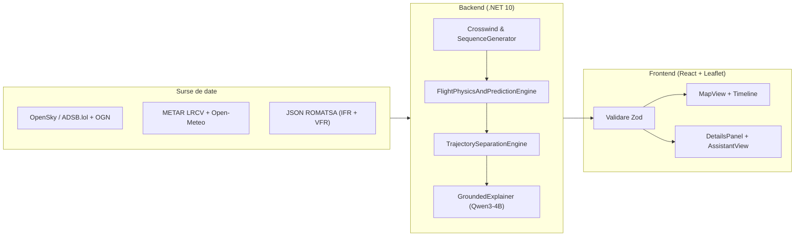

# Documentație tehnică — AERIS (`LRCV`)

Documentația tehnică a aplicației AERIS (KWAD) pentru Aeroportul Internațional Craiova (`LRCV`). Descrie arhitectura proiectului, calculele matematice din motorul de simulare, bazele de date JSON (IFR și VFR), verificarea separării traiectoriilor și interfața web.

---

## 1. Structura generală

Aplicația este împărțită în trei componente:
1. **`AERIS API/` (.NET 10 Web API):** execută calculele de vânt, atmosferă, secvențiere a aterizărilor, prognoză pe 45 de minute, analiză de la decolare la aterizare, redirecționare VFR, verificare a separării traiectoriilor și generarea răspunsurilor asistate de modelul AI local.
2. **`frontend/` (React 19 + TypeScript + Leaflet):** afișează harta radar pentru Craiova, benzile de zbor, cronologia, panoul de detalii și consola Asistentului ATC. Nu recalculează secvența de aterizare; afișează datele primite de la backend (sau din `mockBackend.ts` în modul demonstrativ offline).
3. **`AERIS.Tests/` (.NET 10):** suita de teste automate pentru calculele fizice, separarea traiectoriilor și verificarea răspunsurilor AI.

---

## 2. Datele aerodromului Craiova (`LRCV`) și bazele de date JSON

Geometria folosită în calcule provine din AIP România (AIRAC 2026-10-01):
- **ARP Craiova (`LRCV`):** `44.318056° N, 23.888611° E`, elevație `626 ft` (`191 m`).
- **Pista `08/26` (`2500 m x 45 m`, asfalt):**
  - Pragul `08`: relevment adevărat `88.93°`, elevație `678 ft`.
  - Pragul `26`: relevment adevărat `268.95°`, elevație `669 ft` (echipată cu ILS Cat I și procedură RNP).
  - `RunwayConfiguration.cs` acceptă atât notația oficială `08/26`, cât și notația anterioară `09/27`.
- **Aerodromul Balta Verde Craiova (`LRCW`):** `44.286389° N, 23.791111° E`, elevație `450 ft`, pistă înierbată `920 m x 40 m`, administrat de **Aeroclubul României** (Aeroclubul Teritorial „George Valentin Bibescu” Craiova) — singurul aerodrom al Craiovei destinat aviației ușoare și planorismului.
- **Aerodrom Slatina (`SLATINA`):** `44.4240° N, 24.4420° E`, pistă înierbată `700 m`, păstrat ca punct secundar de rezervă la `46 km` est de Craiova.

### Bazele de date ROMATSA (`AERIS API/data/`)
- **`romatsa-ifr-mock-db.json`:** conține regulile de separare din FIR București (`LRBB`), matricea ICAO pentru turbulența de siaj (`Heavy`, `Medium`, `Light`), procedurile instrumentale `ILS/RNP RWY 26` (`TITEK`, `PEMOK`, `PANZU` -> `OZZET` -> `CV508` -> `THR 26`) și `RNP RWY 08` (`NECCO` -> `CV408` -> `THR 08`), zonele de holding la `OZZET` și `NECCO`, parametrii de performanță pentru `A320-232`, `A321neo`, `ATR 72-600`, `B737-800`, `E190` și aeroporturile de rezervă IFR (`LROP`, `LRTR`, `LRSB`, `LBSF`).
- **`romatsa-vfr-mock-db.json`:** conține punctele de intrare VFR (`VFR-S`, `VFR-N`, `VFR-W`), plafoanele și vizibilitatea minimă VMC (SERA.5001), datele pentru aeronavele ușoare (`ICP Savannah S`, `PZL-104 Wilga 35A`, `Cessna 172S`, `Diamond DA40`, `Tecnam P2008JC`) și aerodromurile de redirecționare VFR (**Aerodromul Balta Verde Craiova `LRCW`** ca punct principal și **Aerodrom Slatina `SLATINA`** ca punct secundar).

---

## 3. Calculele din motorul de simulare (`FlightPhysicsAndPredictionEngine.cs`)

### 3.1. Atmosfera ISA, altitudinea de densitate și viteza adevărată (TAS)
Temperatura standard la nivelul aerodromului ($h = 626\text{ ft}$):
$$T_{\text{ISA}}(h) = 15 - 0.0019812 \cdot h \approx 13.76^\circ\text{C}$$

Altitudinea barometrică ($\text{PA}$) și altitudinea de densitate ($\text{DA}$):
$$\text{PA} = h_{\text{elev}} + (1013.25 - \text{QNH}) \cdot 27.3$$
$$\text{DA} = \text{PA} + 118.8 \cdot (\text{OAT} - T_{\text{ISA}})$$

Din raportul de densitate $\sigma = \rho / \rho_0$ se calculează viteza adevărată ($\text{TAS}$) pornind de la viteza indicată ($\text{IAS}$):
$$\text{TAS} = \frac{\text{IAS}}{\sqrt{\sigma}}$$

### 3.2. Vântul la 2000 ft și 5000 ft (Hellmann + Ekman)
Vântul raportat la sol ($10\text{ m} \approx 33\text{ ft}$) crește cu altitudinea și își rotește direcția:
- **Viteza la înălțimea $h_{\text{AGL}}$:**
  $$V(h_{\text{AGL}}) = V_{\text{ref}} \cdot \left(\frac{\max(h_{\text{AGL}}, 33)}{33}\right)^\alpha$$
  unde $\alpha \in [0.14, 0.22]$ depinde de diferența dintre rafală și vântul mediu.
- **Rotația direcției vântului cu altitudinea:**
  $$\theta(h_{\text{AGL}}) = \left(\theta_{\text{sol}} + 18^\circ \cdot \left(1 - e^{-h_{\text{AGL}} / 2500}\right)\right) \bmod 360^\circ$$

### 3.3. Prognoza pe 45 de minute (`T+0`, `T+5m`, `T+10m`, `T+15m`, `T+30m`, `T+45m`)
Pentru fiecare dintre cele 6 orizonturi viitoare, `BuildFuturePrediction` estimează viteza vântului și a rafalelor, recalculează pista activă și vântul lateral, verifică dacă se deschide o fereastră sigură pentru VFR ($\text{crosswind} \le 12\text{ kt}$ și vizibilitate $\ge 5000\text{ m}$) și numără câte aeronave mai sunt în aer sau în așteptare la acel minut.

### 3.4. Triunghiul vitezelor și unghiul de derivă (`WCA`)
Pentru o aeronavă cu viteza adevărată $\text{TAS}$ pe drumul $\chi$ și vânt $V_w$ din direcția $\theta_w$:
$$\Delta\theta = \theta_w - \chi, \qquad V_{\text{xw}} = V_w \sin(\Delta\theta), \qquad V_{\text{hw}} = V_w \cos(\Delta\theta)$$
$$\text{WCA} = \arcsin\left(\frac{V_{\text{xw}}}{\text{TAS}}\right), \qquad \text{HDG} = (\chi + \text{WCA}) \bmod 360^\circ, \qquad \text{GS} = \text{TAS} \cos(\text{WCA}) - V_{\text{hw}}$$

### 3.5. Analiza de la decolare la aterizare (6 faze)
Funcția `BuildTakeoffToLanding` împarte zborul în 6 segmente (`Takeoff`, `Cruise`, `Top of Descent`, `Initial Approach`, `Final Approach 3.0°`, `Landing Rollout`) și calculează:
- **Distanța până la Top of Descent ($\text{TOD}$):** $3\text{ NM}$ pentru fiecare $1000\text{ ft}$ de coborât + $1\text{ NM}$ per $10\text{ kt}$ decelerare + distanța FAF.
- **Rata de coborâre pe panta de $3^\circ$ ($\text{ROD}$):**
  $$\text{ROD}_{\text{fpm}} = \text{GS}_{\text{app}} \cdot \frac{6076.12}{60} \cdot \tan(3^\circ) \approx 5.31 \cdot \text{GS}_{\text{app}}$$
- **Distanța de aterizare necesară ($\text{LDR}$):** ține cont de viteza față de sol la prag ($V_{\text{ref}} - V_{\text{hw}}$), de densitatea aerului ($1/\sigma$), de decelerația la frânare pe asfalt sau iarbă și de un factor de siguranță de $1.15$, raportând rezultatul la lungimea pistei ($2500\text{ m}$ pe `LRCV`).

### 3.6. Predicția cu 2 pași înainte (`CurrentState` -> `StepOneAhead` -> `StepTwoAhead`)
Pentru fiecare aeronavă se calculează trei poziții legate de timpul planificat de aterizare ($t_{\text{target}}$):
1. **$T_0$:** intrarea în sectorul Craiova ($12\text{–}15\text{ NM}$ de prag).
2. **Pasul +1:** poziția tactică intermediară (`OZZET` pe pista 26, `NECCO` pe pista 08, intrarea în așteptare la Cârcea sau punctul de redirecționare).
3. **Pasul +2:** atingerea pragului pistei `LRCV` sau aterizarea pe aerodromul de rezervă (`LRCW`).

### 3.7. Decizia VFR: așteptare în orbită vs. redirecționare (`PNR` și scorul `0–100`)
Când o aeronavă VFR nu poate ateriza imediat pe Craiova din cauza vântului lateral sau a traficului IFR:
1. **Point of No Return ($\text{PNR}$):**
   Ține cont de combustibilul rămas, consumul redus în circuitul de așteptare ($\dot{m}_{\text{holding}} \approx 0.78 \cdot \dot{m}_{\text{croazieră}}$), timpul de zbor până la aerodromul de rezervă și rezerva legală VFR. Dacă marja $\text{PNR} < 12\text{ min}$, sistemul recomandă redirecționarea imediată.
2. **Evaluarea aerodromurilor de rezervă ($0\text{–}100$):**
   Sistemul evaluează **Aerodromul Balta Verde Craiova (`LRCW`, administrat de Aeroclubul României)** ca punct principal ($11.8\text{ km}$, azimut $245^\circ$, pistă înierbată $920\text{ m}$) și **Aerodrom Slatina (`SLATINA`)** ca punct secundar ($46.0\text{ km}$, azimut $75^\circ$, pistă înierbată $700\text{ m}$), combinând scorul de vânt lateral (max 50p), vânt de față (max 20p), proximitate (max 15p) și marja pistei (max 15p).

---

## 4. Separarea traiectoriilor (`Services/TrajectorySeparation/`)

- **`TrajectoryPredictor.cs` și `RacetrackGenerator.cs`:** generează punctele de traiectorie $(\text{lat}, \text{lon}, \text{alt}, t)$ din 5 în 5 secunde pe procedurile RNP și construiesc circuitele de așteptare tip hipodrom (viraj standard de $180^\circ$, latură outbound de $60\text{ s}$, viraj de $180^\circ$, latură inbound).
- **`TrajectorySeparationEngine.cs`:** verifică la fiecare pas de timp distanța orizontală și verticală între oricare două aeronave ($3\text{ NM}$ / $1000\text{ ft}$ pentru IFR-IFR, $1.5\text{ NM}$ / $500\text{ ft}$ pentru IFR-VFR), intervalele de turbulență de siaj pe pistă și ocuparea pistei.
- **`SafePlanningCoordinator.cs`:** dacă detectează un conflict, decalează automat slotul de aterizare sau eșalonează vertical așteptarea cu $1000\text{ ft}$ până la eliminarea conflictului.

---

## 5. Modulul AI local (`GroundedExplainer.cs`)

Endpoint-ul `POST /api/craiova/explain` funcționează în trei pași:
1. Backendul construiește o listă de enunțuri verificate direct din rezultatele matematice ale simulării sau din telemetria live (`decision`, `weather`, `landing_sequence`, `future_prediction`, `two_steps_ahead`, `takeoff_to_landing`, `vfr_redirection`, `trajectory_separation`, `flight_<id>`).
2. Modelul local `Qwen3-4B-Instruct-2507` (rulat pe `http://127.0.0.1:18090/v1/chat/completions` prin `llama-server`) sintetizează răspunsul în limba română exclusiv pe baza acestor enunțuri.
3. Verificatorul C# validează fiecare valoare numerică din răspuns față de datele sursă. Dacă o cifră nu corespunde sau dacă serverul LLM este oprit, backendul returnează automat sinteza deterministă C#.

---

## 6. Rutele API disponibile

| Rută | Metodă | Rol |
|---|---|---|
| `/api/craiova/evaluate` | `POST` | Evaluează vremea și lista de aeronave trimise din Demo; returnează sloturile și toate calculele matematice. |
| `/api/craiova/simulation` | `GET` | Rulează simularea pentru parametrii meteo din query (`windSpeed`, `windDirection`, `windGust`, `visibility`). |
| `/api/craiova/alternates` | `GET` | Returnează calculele pentru **Aerodromul Balta Verde Craiova (`LRCW`)** și **Aerodrom Slatina (`SLATINA`)**. |
| `/api/craiova/explain` | `POST` | Returnează explicația verificată în limba română pentru modul Live sau Demo. |
| `/api/craiova/romatsa/vfr` | `GET` | Returnează conținutul `romatsa-vfr-mock-db.json`. |
| `/api/craiova/romatsa/ifr` | `GET` | Returnează conținutul `romatsa-ifr-mock-db.json`. |
| `/api/craiova/romatsa/summary` | `GET` | Sumar al datelor din cele două baze ROMATSA. |
| `/api/craiova/live-positions` | `GET` | Pozițiile reale ale aeronavelor din OpenSky Network (cu fallback automat ADSB.lol). |
| `/api/craiova/live-traffic` | `GET` | Traficul convertit în format de scenariu (`?forceSimulated=true` pentru datele de demo). |
| `/api/craiova/vfr/tracking` | `GET` | Urmărirea aeronavelor VFR față de punctele `VFR-S`, `VFR-N`, `VFR-W`. |
| `/api/separation/evaluate` | `POST` | Evaluează separarea traiectoriilor și returnează varianta replanificată fără conflicte. |
| `/api/separation/demo-conflict` | `GET` | Scenariu demonstrativ cu conflict de siaj rezolvat automat. |
| `/api/planning/evaluate` | `POST` | Calculează variantele valide de secvențiere pentru o listă de aeronave. |
| `/api/weather/metar/decoded` | `GET` | METAR-ul curent pentru `LRCV` decodat (cu fallback meteo multi-sursă). |
| `/api/weather/vmc-check` | `GET` | Verifică dacă vremea curentă permite zborul VFR (SERA.5001). |
